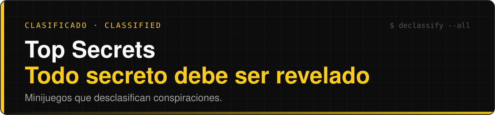

<div align="center">




</div>


## Qué es

**Top Secrets** es una colección de minijuegos para el navegador. Cada partida suma puntos y, al cruzar ciertos umbrales, se desclasifica un secreto: una conspiración redactada con la seriedad de un expediente oficial. El juego está en cinco idiomas: español, inglés, francés, ruso y chino simplificado. Está hecho con HTML, CSS y JavaScript, sin dependencias ni compilación.

> **English version below** → [English](#english)

## Índice

- [Qué es](#qué-es)
- [Cómo jugar](#cómo-jugar)
- [Cómo funciona](#cómo-funciona)
- [Estructura del repositorio](#estructura-del-repositorio)
- [Cómo se hizo](#cómo-se-hizo)
- [Reparto del trabajo](#reparto-del-trabajo)
- [Agradecimientos](#agradecimientos)


## Cómo jugar

Requisitos: un navegador moderno y Python 3 (o cualquier servidor estático).

```bash
git clone https://github.com/ramonolivermartos/TopSecret.git
cd TopSecret
python -m http.server 8000 --bind 127.0.0.1
```

Abre <http://127.0.0.1:8000/>. En Linux y macOS, usa `python3` en lugar de `python`.

Verás el menú de juegos. Elige uno, juega y vigila el contador: el siguiente secreto está a unos cuantos puntos.

> [!WARNING]
> No abras `index.html` con doble clic. Desde `file://` el navegador bloquea parte de los recursos y el juego no carga bien.

## Cómo funciona

- **Minijuegos.** `allin`, `calculadora`, `snake`, `laberinto`, `tetrareplica` y `francotirador`. Todos alimentan el mismo marcador.
- **Umbrales.** Una secuencia fija de puntuaciones, de unos cientos de puntos hasta 9.999.550, decide cuándo se desbloquea cada secreto. Hay 633 previstos.
- **Secretos.** Relatos de 450 a 550 palabras en tono institucional. La regla es que el absurdo sea administrativamente posible: nada de magia, solo burocracia llevada hasta sus últimas consecuencias.
- **Localización con criterio.** Cada idioma no solo traduce: adapta las referencias a la idiosincrasia administrativa de su región. Un trámite imposible en Madrid no se tuerce igual que en París, Moscú o Pekín.
- **Mensajes.** 50 frases de victoria, 50 de derrota y un catálogo de descripciones del jugador, en los cinco idiomas.


## Estructura del repositorio

```text
TopSecret/
├── index.html
├── AGENTS.md                    estructura, contratos y flujo de trabajo
├── skills/                      guías por componente
├── scripts/
│   ├── games-data.js            registro de juegos
│   ├── i18n.js                  selector de idioma
│   ├── localization-data.js     catálogo generado (no se edita)
│   ├── secrets-data.js          secretos generados (no se edita)
│   ├── messages-data.js         mensajes generados (no se edita)
│   ├── build-translations.py    valida textos y genera los catálogos
│   └── textos.py                sincroniza con un Drive privado (no hace falta para jugar)
├── tests/                       tests de Node y de la secuencia de secretos
└── Textos/
    ├── CONVENTIONS.md           la única especificación de los textos
    ├── Directives/              guía narrativa y secuencia de umbrales
    └── <ES|EN|FR|RU|ZH>/
        ├── Common/              interfaz compartida
        ├── Games/<juego>/       textos de cada juego
        ├── Messages/            victoria y derrota
        ├── Player/              descripciones del jugador
        └── Secrets/             secreto_NNN.md
```

El código no contiene textos. Todo vive en Markdown dentro de [`Textos/`](Textos/), con el español como origen: los otros cuatro idiomas se traducen directamente desde él, nunca desde el inglés. Las reglas completas están en [`Textos/CONVENTIONS.md`](Textos/CONVENTIONS.md).

Para regenerar el catálogo y pasar los tests hacen falta Python 3 y Node:

```sh
python scripts/build-translations.py         # valida los cinco idiomas y genera el catálogo
node --test tests/*.cjs                      # tests
python tests/secret-sequence.py              # comprueba la secuencia de umbrales
```

Para entrar en el código, empieza por [`AGENTS.md`](AGENTS.md) (estructura, contratos y flujo de trabajo) y por [`skills/`](skills/README.md), que tiene una guía por componente: juegos, menú, guardado, textos, audio.


## Cómo se hizo

Este proyecto está hecho con vibe coding, pero no del tipo «pide, copia y pega». Cada respuesta de la IA ha sido una propuesta, no una entrega: la he discutido, corregido, rechazado y vuelto a pedir hasta que hacía lo que yo tenía en la cabeza. Buena parte del tiempo no se ha ido en escribir código, sino en pelearme con él.

La parte menos visible es la organización. Montar un proyecto en el que dos instancias de Claude trabajan a la vez sin pisarse ha exigido reglas claras:

- **Claude Code** escribe el código, los textos de interfaz y las herramientas de validación y sincronización.
- **Claude (web)** redacta los secretos en español y los traduce a los otros cuatro idiomas.
- **Un único documento de convenciones** fija nombres, formatos, responsables y flujos. Cada tipo de texto tiene un solo dueño, y quien no es dueño no lo toca.
- **Repositorio y Drive son copias idénticas**, y los scripts comprueban que lo sigan siendo.

La IA escribe rápido. Decidir qué se queda es lo lento.

## Reparto del trabajo

Lo digo claro: esto es un **50 % Claude y un 50 % mío**.

| Yo                                                | Claude                                                 |
| ------------------------------------------------- | ------------------------------------------------------ |
| La idea, el tono y el sentido del humor del juego | La mayor parte del código                              |
| El diseño de los minijuegos y sus mecánicas       | La redacción de los secretos a partir de mis premisas  |
| Las premisas de cada secreto                      | Las traducciones a EN, FR, RU y ZH                     |
| La arquitectura del proyecto y sus convenciones   | Las herramientas de validación, sincronización y tests |
| La revisión de cada respuesta y de cada texto     | Las iteraciones, todas las que hicieron falta          |

Ninguna de las dos mitades funciona sin la otra.

## Agradecimientos

A Claude, por dejarse orquestar tan bien: por aguantar las correcciones, las vueltas atrás y los «otra vez, pero mejor» sin perder el hilo.


## English

**Top Secrets** is a collection of browser minigames. Every game adds to your score and, when you cross certain thresholds, a secret is declassified: a conspiracy written with the gravity of an official file. The game is available in Spanish, English, French, Russian and Simplified Chinese.

### How to play

You need a modern browser and Python 3 (or any static server). The game is plain HTML, CSS and JavaScript, with no dependencies and no build step.

```bash
git clone https://github.com/ramonolivermartos/TopSecret.git
cd TopSecret
python -m http.server 8000 --bind 127.0.0.1
```

Open <http://127.0.0.1:8000/> (use `python3` on Linux and macOS), pick a game and watch the counter. Do not open `index.html` by double-clicking it: browsers block part of the resources under `file://`.

### How it works

- **Minigames.** `allin`, `calculadora`, `snake`, `laberinto`, `tetrareplica` and `francotirador`, all feeding the same score.
- **Thresholds.** A fixed sequence of scores, from a few hundred points up to 9,999,550, unlocks each secret. 633 are planned.
- **Secrets.** 450–550-word stories in an institutional tone. The rule: the absurd must be administratively possible. No magic, only bureaucracy taken to its logical extreme.
- **Localization with judgement.** Each language adapts the references to its own region's administrative quirks. Spanish is the source; every other language is translated directly from it, never from English.

See [Repository structure](#estructura-del-repositorio) above for the layout and commands.

### How it was made

This project was built with vibe coding, but not the copy-paste kind. Every AI answer was a proposal, not a delivery: I argued with it, corrected it, rejected it and asked again until it matched what I had in mind. Much of the work went into organizing the project so that two Claude instances could work in parallel without stepping on each other: Claude Code for the code and tooling, Claude on the web for writing and translating the secrets, and one conventions document that defines names, formats, owners and workflows.

### Who did what

This is **50% Claude, 50% me**. I brought the idea, the tone, the game design, the premise of each secret, the project architecture and the review of every answer. Claude wrote most of the code, the secrets from my premises, the translations and the tooling. Neither half works without the other.

### Thanks

To Claude, for letting itself be orchestrated so well, and for putting up with every "again, but better".

<div align="center">

**Top Secrets** · Desclasificado por accidente

</div>
